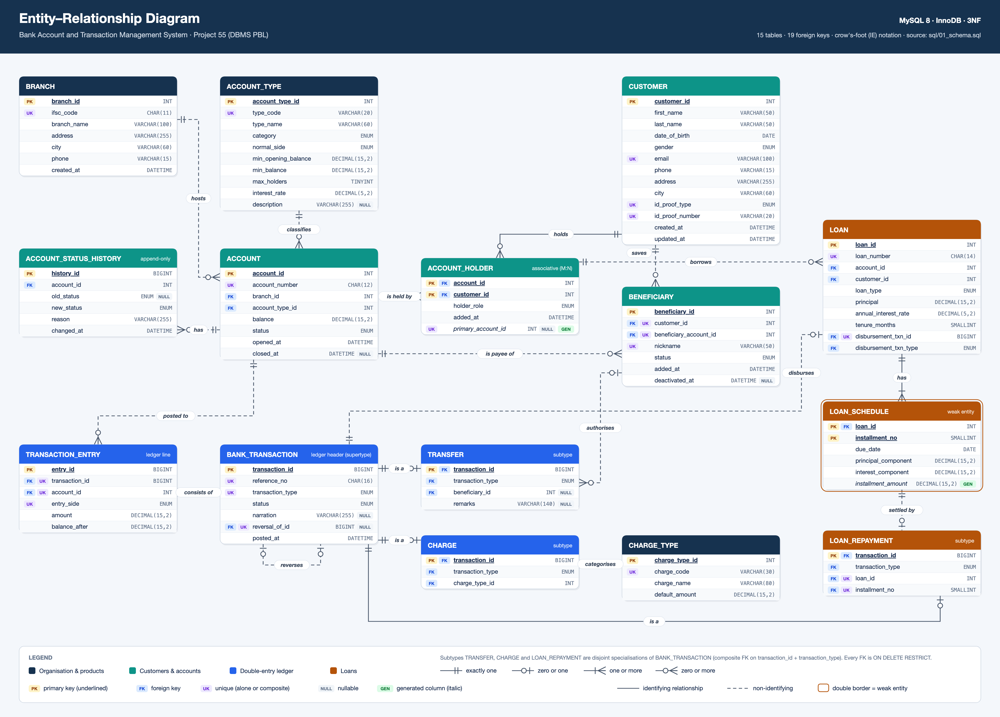
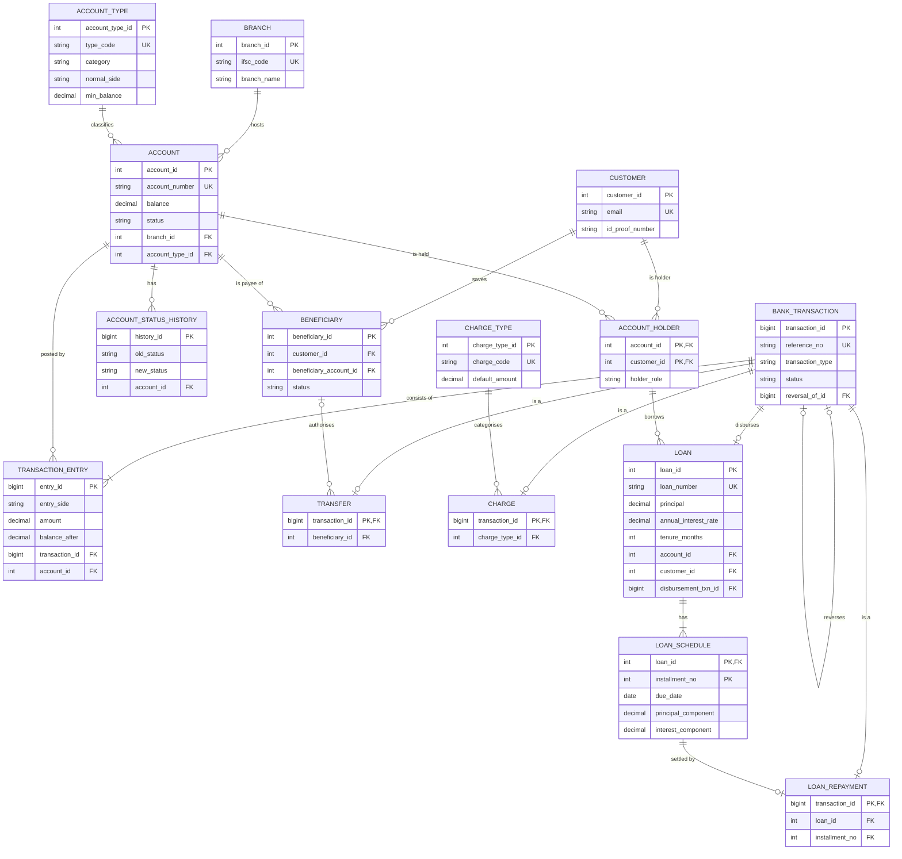

# 02 — Domain and ER Model (Gate 2)

This document is the conceptual design. It is derived from the requirements and business rules in [01_requirements.md](01_requirements.md) (FR-xx, BR-xx). The relational schema in [03_relational_design.md](03_relational_design.md) is derived from this model.

## 1. Design decisions that shape the model

| # | Decision | Reason | Label |
|---|---|---|---|
| E1 | A financial event is modelled as **Bank Transaction** (header) + **Transaction Entry** (one debit or credit line per account) | Makes debit/credit explicit and lets "debits = credits" be checked (BR-16/17) | Approved 2026-10-03 |
| E2 | The bank's own books are five **internal accounts** (CASH, LOAN_RECEIVABLE, FEE_INCOME, INTEREST_INCOME, CAPITAL) of category INTERNAL | Lets deposits, withdrawals, charges and loans balance (BR-16) | Approved 2026-10-03 |
| E3 | **Transfer, Charge, Loan disbursement and Loan Repayment** are specialisations of Bank Transaction. They hold only what is specific to them; amounts and accounts live in the entries | Avoids storing the same amount/account twice (update anomalies) | PROPOSED ASSUMPTION |
| E4 | **Statement** is not an entity. It is derived from entries for a period | Review 1 decision; storing it would duplicate ledger data | Review 1 |
| E5 | Loan Schedule is a **weak entity** of Loan (identified by loan + instalment number) | An instalment has no identity outside its loan | PROPOSED ASSUMPTION |
| E6 | Instalment amount, paid/overdue status, loan status and outstanding principal are **derived attributes** | They are computable from stored facts; storing them invites drift (BR-35/36) | PROPOSED ASSUMPTION |
| E7 | Account Type is a **product** that carries rules (minimum opening balance, minimum balance, maximum holders, normal side) | FR-10, BR-04 | PROPOSED ASSUMPTION |

## 2. Entities and attributes

Notation: **PK** primary key · **CK** other candidate key · **FK** foreign key · *derived* = not stored.

### 2.1 Branch
| Attribute | Notes |
|---|---|
| branch_id | **PK** (surrogate) |
| ifsc_code | **CK** — 11-character branch code, unique |
| branch_name | |
| address, city | |
| phone | |
| created_at | |

### 2.2 Account Type (product)
| Attribute | Notes |
|---|---|
| account_type_id | **PK** |
| type_code | **CK** — e.g. SAVINGS, CURRENT, SALARY, GL_ASSET, GL_INCOME, GL_EQUITY |
| type_name | |
| category | CUSTOMER or INTERNAL |
| normal_side | DEBIT or CREDIT. Customer products are always CREDIT (BR-06) |
| min_opening_balance | ≥ 0 |
| min_balance | ≥ 0, ≤ min_opening_balance |
| max_holders | ≥ 1 for CUSTOMER, 0 for INTERNAL |
| interest_rate | Informational (no accrual — out of scope) |
| description | |

### 2.3 Customer
| Attribute | Notes |
|---|---|
| customer_id | **PK** |
| first_name, last_name | |
| date_of_birth | Not in future (BR-03) |
| gender | |
| email | **CK** (BR-01) |
| phone | Not unique (family members may share a phone) |
| address, city | |
| id_proof_type, id_proof_number | **CK** as a pair (BR-01) |
| created_at, updated_at | |
| *age* | *derived* from date_of_birth |

### 2.4 Account
| Attribute | Notes |
|---|---|
| account_id | **PK** |
| account_number | **CK** — 12-digit, unique |
| balance | Stored. Controlled redundancy: equals the net of the account's entries (BR-20). Justified in 03 §5 |
| status | ACTIVE / FROZEN / BLOCKED / CLOSED |
| opened_at | |
| closed_at | Present if and only if status = CLOSED |

### 2.5 Account Holder (associative entity: Customer M:N Account)
| Attribute | Notes |
|---|---|
| account_id, customer_id | **PK** (composite); each is an **FK** |
| holder_role | PRIMARY or JOINT. Exactly one PRIMARY per account (BR-08) |
| added_at | |

### 2.6 Account Status History
| Attribute | Notes |
|---|---|
| history_id | **PK** |
| old_status | Empty for the opening record |
| new_status | |
| reason | |
| changed_at | |

### 2.7 Bank Transaction (ledger header)
| Attribute | Notes |
|---|---|
| transaction_id | **PK** |
| reference_no | **CK** — unique human-readable reference (BR-18) |
| transaction_type | DEPOSIT, WITHDRAWAL, TRANSFER, CHARGE, LOAN_DISBURSEMENT, LOAN_REPAYMENT, REVERSAL, CAPITAL_INJECTION |
| status | POSTED or REVERSED |
| narration | |
| posted_at | |
| *amount* | *derived* = Σ debit entries |

### 2.8 Transaction Entry (ledger line; weak in meaning, but given a surrogate key)
| Attribute | Notes |
|---|---|
| entry_id | **PK** |
| entry_side | DEBIT or CREDIT |
| amount | > 0 |
| balance_after | Account balance immediately after this entry. A point-in-time historical fact, used for statements |

### 2.9 Transfer (specialisation of Bank Transaction)
| Attribute | Notes |
|---|---|
| transaction_id | **PK**, **FK** → Bank Transaction |
| remarks | |
| *source account, destination account, amount* | *derived* from the transaction's entries |

### 2.10 Beneficiary
| Attribute | Notes |
|---|---|
| beneficiary_id | **PK** |
| (customer_id, beneficiary_account_id) | **CK** (BR-26) |
| nickname | Updatable (BR-28) |
| status | ACTIVE / INACTIVE |
| added_at, deactivated_at | deactivated_at present if and only if INACTIVE |
| *payee name* | *derived* from the payee account's primary holder |

### 2.11 Charge Type
| Attribute | Notes |
|---|---|
| charge_type_id | **PK** |
| charge_code | **CK** — e.g. SMS_ALERT_FEE |
| charge_name | |
| default_amount | > 0 |

### 2.12 Charge (specialisation of Bank Transaction)
| Attribute | Notes |
|---|---|
| transaction_id | **PK**, **FK** → Bank Transaction |
| *account, amount charged* | *derived* from entries. The amount charged may differ from the type's default (BR-29), so it is a separate fact |

### 2.13 Loan
| Attribute | Notes |
|---|---|
| loan_id | **PK** |
| loan_number | **CK** — unique human-readable reference |
| loan_type | PERSONAL / HOME / VEHICLE / EDUCATION |
| principal | > 0 |
| annual_interest_rate | > 0, ≤ 36 |
| tenure_months | 1–360 |
| disbursement transaction | **CK**, **FK** → Bank Transaction (the LOAN_DISBURSEMENT) |
| *EMI* | *derived* = first instalment's amount (stored per instalment, not on the loan) |
| *disbursed_on* | *derived* = date of the disbursement transaction |
| *status, outstanding principal* | *derived* (BR-35, BR-36) |

### 2.14 Loan Schedule (weak entity of Loan)
| Attribute | Notes |
|---|---|
| loan_id + installment_no | **PK** (identifying relationship with Loan) |
| due_date | |
| principal_component, interest_component | |
| *installment_amount* | *derived* = principal + interest |
| *paid, overdue* | *derived* (BR-35) |

### 2.15 Loan Repayment (specialisation of Bank Transaction; settles one instalment)
| Attribute | Notes |
|---|---|
| transaction_id | **PK**, **FK** → Bank Transaction |
| (loan_id, installment_no) | **CK**, **FK** → Loan Schedule. One repayment per instalment (BR-34) |
| *amount, payment date* | *derived* from the transaction's entries and posted_at |

## 3. Relationships and cardinalities

| # | Relationship | Cardinality | Participation | Rule |
|---|---|---|---|---|
| R1 | Branch **hosts** Account | 1 : N | Account total, Branch partial | BR-07 |
| R2 | Account Type **classifies** Account | 1 : N | Account total, Type partial | BR-07 |
| R3 | Customer **holds** Account (via Account Holder) | M : N | Customer account partial; customer accounts have ≥ 1 holder; internal accounts have none | BR-08 |
| R4 | Account **has** Status History | 1 : N | History total | BR-14 |
| R5 | Bank Transaction **consists of** Transaction Entry | 1 : N (N ≥ 2) | Entry total | BR-16 |
| R6 | Account **is posted by** Transaction Entry | 1 : N | Entry total | |
| R7 | Bank Transaction **reverses** Bank Transaction | 1 : 0..1 (recursive) | Optional both sides | BR-19 |
| R8 | Bank Transaction **is a** Transfer / Charge / Loan Repayment | ISA, disjoint, partial | A transaction is at most one specialisation, matching its type | E3 |
| R9 | Customer **saves** Beneficiary | 1 : N | Beneficiary total | BR-26 |
| R10 | Account **is payee of** Beneficiary | 1 : N | Beneficiary total | BR-26 |
| R11 | Beneficiary **authorises** Transfer | 1 : N | Transfer partial (own-account transfers have none) | BR-25 |
| R12 | Charge Type **categorises** Charge | 1 : N | Charge total | BR-29 |
| R13 | Account Holder **borrows** Loan (borrower holds the loan's account) | 1 : N | Loan total | BR-31 |
| R14 | Bank Transaction **disburses** Loan | 1 : 1 | Loan total | |
| R15 | Loan **has** Loan Schedule (identifying) | 1 : N | Schedule total | E5 |
| R16 | Loan Schedule **is settled by** Loan Repayment | 1 : 0..1 | Repayment total, Schedule partial | BR-34 |

**R13** is drawn from Account Holder rather than from Customer and Account separately. A loan's (account, customer) pair must be an existing holding, so the database itself rejects a borrower who does not hold the account (fixes audit defect D-06).

## 4. ER diagram

Full diagram (all 15 tables with every column, data type, PK/FK/UK, nullable and generated columns, all 19 foreign keys in crow's-foot notation): [PNG](diagrams/er_diagram.png) · [SVG](diagrams/er_diagram.svg) · [PDF](diagrams/er_diagram.pdf). It was cross-checked against the live database's `information_schema`. The Mermaid source below is a condensed summary rendered by GitHub; full column definitions are in 03.

## 5. Business rules the ER model cannot express

These are enforced in the relational layer (CHECK, composite FK, generated column) or in Java. See [03_relational_design.md §7](03_relational_design.md#7-constraint-catalogue) for where each one lives.

- Debits = credits per transaction (BR-17): cross-row, so it is enforced by the Java posting engine and checked by a verification query.
- A specialisation row must match its parent's transaction type (E3): enforced by a composite FK on (transaction_id, transaction_type).
- Exactly one PRIMARY holder per account (BR-08).
- The holder limit per product (BR-08), the age rule (BR-02) and lifecycle transitions (BR-12) are enforced in Java.

## 6. Mapping to the required domain list

| Required entity | Modelled as |
|---|---|
| Customers | Customer |
| Branches | Branch |
| Account Types | Account Type (product) |
| Accounts | Account (+ Account Status History) |
| Account Holders | Account Holder |
| Transactions | Bank Transaction + Transaction Entry |
| Transfers | Transfer |
| Beneficiaries | Beneficiary |
| Charges | Charge + Charge Type |
| Loans | Loan |
| Loan Schedules | Loan Schedule |
| Loan Repayments | Loan Repayment |
| Statements | Derived report over Transaction Entry (E4) |

## 7. Changes from the Review 1 model (12 tables)

| Review 1 | Now | Why |
|---|---|---|
| bank_transaction: one row per account movement, type implies direction | Header + Transaction Entry with explicit DEBIT/CREDIT | Explicit, verifiable debit/credit balance |
| transfer stores from/to/amount and two transaction IDs | Transfer is a specialisation holding beneficiary and remarks | Removes duplicated data and the unreachable FAILED status |
| charge.transaction_id nullable; charge type ENUM | Charge always tied to a transaction; Charge Type catalogue | A charge without a ledger entry is impossible; fee defaults live in one place |
| loan stores emi_amount and status | Both derived | emi depends on (principal, rate, tenure), a transitive dependency; status drifts |
| loan_schedule stores status (incl. OVERDUE) | Derived | OVERDUE depends on today's date |
| loan_repayment stores loan_id and schedule_id | Identified by the instalment's composite key | Removes the redundant loan_id that could disagree |
| (none) | Account Status History, Charge Type, internal accounts | Lifecycle audit; product/fee catalogue; balanced ledger |
| beneficiary may be external, stores account number text | Beneficiary is always an internal account; status instead of delete | No external payment network in scope; history kept |
