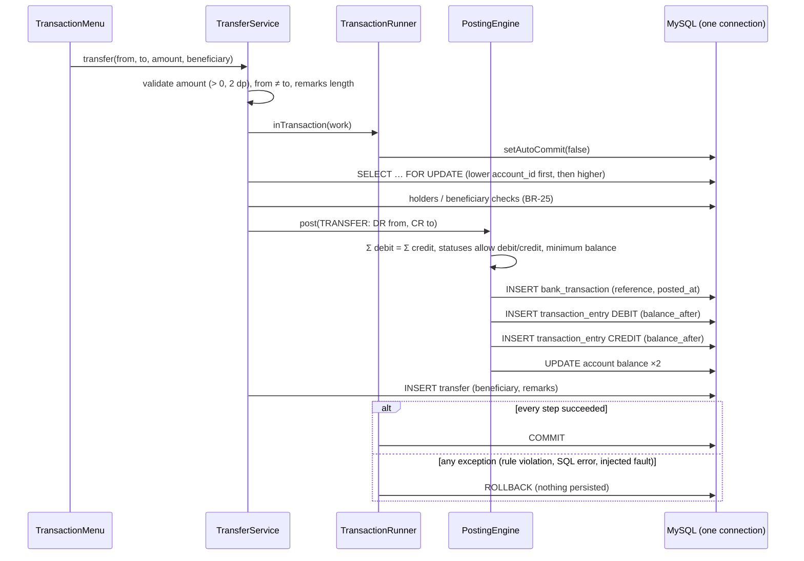

# 05 — Application Architecture (Gates 6–11)

## 1. Layers

```
Presentation   com.bankdbms.ui        console menus: input, output, error display
     ↓
Service        com.bankdbms.service   business rules, validation, transaction boundaries
     ↓
Ledger         com.bankdbms.ledger    PostingEngine: the only code that moves money
     ↓
DAO            com.bankdbms.dao       one class per table + ReportDao; PreparedStatement only
     ↓
JDBC           com.bankdbms.db        ConnectionFactory, TransactionRunner, JdbcSupport,
                                      SqlErrorTranslator, SqlScriptRunner
     ↓
MySQL 8.0.16+     bank_dbms              constraints, triggers, views (the final integrity boundary)
```

Supporting packages:
- `model`: records and enums mirroring the schema;
- `report`: report value types;
- `util`: `Money`, `Validator`, `LoanCalculator`, `BankClock`, `ReferenceGenerator`;
- `exception`;
- `config`: `DbConfig`;
- `app`: `Main`, `AppContext`;
- `tools`: `SampleDataLoader`.

**Rules the code follows:**
- **No SQL outside DAOs.** The UI never sees a `Connection`.
- **No framework.** `AppContext` wires every object by constructor, so the dependency graph is visible in one file.
- **Money is `BigDecimal`** (scale 2, HALF_EVEN) and DECIMAL(15,2) in MySQL. No `float`/`double` exists in the code base.
- **Every DAO method takes the caller's `Connection`.** Only the service decides what belongs to one database transaction.

## 2. Package and class responsibilities

| Class | Responsibility |
|---|---|
| `DbConfig` | Loads URL/user/password from environment variables, `-Dbankdbms.config`, `./db.properties` or the classpath. Appends `connectionTimeZone=LOCAL`. Never prints the password. |
| `ConnectionFactory` | Opens a connection as the least-privilege `bank_app` user. |
| `TransactionRunner` | `inTransaction(work)`: auto-commit off; COMMIT on success, ROLLBACK on any exception. `readOnly(work)`. Translates `SQLException`s. |
| `SqlErrorTranslator` | Maps MySQL error codes and constraint names (1062 duplicate, 1452 FK, 3819 CHECK, 1644 trigger SIGNAL, 1213 deadlock...) to friendly exceptions. Logs technical detail only. |
| `JdbcSupport` | `queryList` / `queryOne` / `update` / `insertReturningKey` with try-with-resources. LIKE-pattern escaping. Null-safe setters. |
| `AccountLocker` | `SELECT … FOR UPDATE` on a set of accounts, always in ascending `account_id` order. |
| `PostingEngine` | Validates balance (Σ debit = Σ credit). Locks accounts. Applies the lifecycle (which statuses accept debits/credits) and balance rules (`MIN_BALANCE` / `NON_NEGATIVE`). Inserts header + entries with `balance_after`. Updates balances. |
| `CashService` | Deposit (DR CASH / CR account), withdrawal (DR account / CR CASH). |
| `TransferService` | Atomic transfer plus the beneficiary authorisation rule BR-25. |
| `ChargeService` | Charge posting (DR account / CR FEE_INCOME) plus the charge row. |
| `ReversalService` | Mirror-image REVERSAL posting; marks the original REVERSED. |
| `AccountService` | Opening (account + PRIMARY holder + history + opening deposit, one transaction), joint holders, lifecycle transitions, closure with payout. |
| `LoanService` | Disbursement + schedule; exact-instalment repayment split into principal and interest; derived positions. |
| `ReportService` | Statements and all reports, read from views. Runs the invariant checks. |
| `CustomerService`, `BranchService`, `AccountTypeService`, `BeneficiaryService` | CRUD/search with validation. |

## 3. How a transfer stays atomic



Every statement runs on the **same JDBC `Connection`** with auto-commit off. A debit without a credit, or a balance change without entries, can therefore never become visible.

Tests TC-TRF-09 and TC-TRF-10 inject a `SQLException` after the debit entry, and after both entries. They then assert that balances, transaction headers, entries and transfer rows are all unchanged.

## 4. Concurrency

- **Lost updates:** prevented by `SELECT … FOR UPDATE` on every account a posting touches. The balance is read under the lock and written before COMMIT, so concurrent postings to the same account queue behind each other.
- **Deadlocks:** avoided because every operation locks its accounts in ascending `account_id` order (`AccountLocker` uses a `TreeSet`). Two operations can then never wait on each other in a cycle. Loan repayments also lock the `loan` row, and reversals lock the transaction header, so the same instalment or transaction cannot be processed twice concurrently. UNIQUE constraints back both rules up.
- **Isolation level:** InnoDB's default REPEATABLE READ. The locking reads give the guarantees we need.
- **Evidence:** TC-TRF-11 runs 8 threads making 80 transfers in opposite directions between two accounts. It finishes without deadlocks, both balances end where they started, and all invariants hold.
- **Known limitation:** every cash operation locks the single CASH account, so cash postings are serialised bank-wide. At academic scale this is not a problem. A real bank would use per-branch tills or sub-ledgers.

## 5. Error handling

| Layer | Behaviour |
|---|---|
| UI (`Menu`) | Catches `BankException` and prints its message (always operator-safe). Any other exception is logged with its stack trace to `logs/bank-dbms.log`, and the operator sees a generic message. |
| Service | Validates input (`Validator`, `Money`) before opening a transaction. Throws `ValidationException`, `NotFoundException`, `BusinessRuleException`, `InsufficientFundsException`, `AccountStateException`. |
| JDBC | `SqlErrorTranslator` converts database rejections into the same exception types, using constraint names (e.g. `uq_customer_email` → "A customer with this email address already exists."). Deadlocks and lock timeouts become "Please try again". Unknown errors become a generic `DataAccessException`, with details logged only. |
| Database | Constraints and triggers reject anything the Java layer missed (defence in depth). |

## 6. Security

- **Credentials:** never in source control. `db.properties` and `src/test/resources/db.properties` are gitignored; `*.example` templates are provided. `DbConfig.toString()` masks the password. The runtime config is not packaged into the jar.
- **Least privilege:** `bank_app` has `SELECT, INSERT, UPDATE` only. No `DELETE` (tested: TC-JDBC-03), no DDL, no TRIGGER. Schema objects are installed by an administrator.
- **SQL injection:** every query with user input is a `PreparedStatement` with bind parameters. LIKE wildcards in search text are escaped. Only `SqlScriptRunner` uses `Statement.execute`, and only for the project's own trusted script files.
- **Sensitive data:** ID-proof numbers are masked in the UI (`******234F`). Logs contain SQL states and error codes, never passwords (checked: zero occurrences).

## 7. Time

The application writes all business timestamps from `BankClock`. Production uses the system clock. Tests and the sample-data generator use `AdjustableBankClock`, which lets real business logic produce dated history (for example overdue loans).

`connectionTimeZone=LOCAL` keeps JDBC from shifting `DATETIME` values (see [03 §8](03_relational_design.md#8-time-handling)).

## 8. Testability seams

- `AppContext(config, clock, faultInjector)`: tests swap the clock and inject database failures into the posting engine (`PostingFaultInjector`). Production uses `PostingFaultInjector.NONE`.
- `TestDatabase` rebuilds `bank_dbms_test` from the real `/sql` scripts before each test class. It refuses any database whose name does not end in `_test`.
