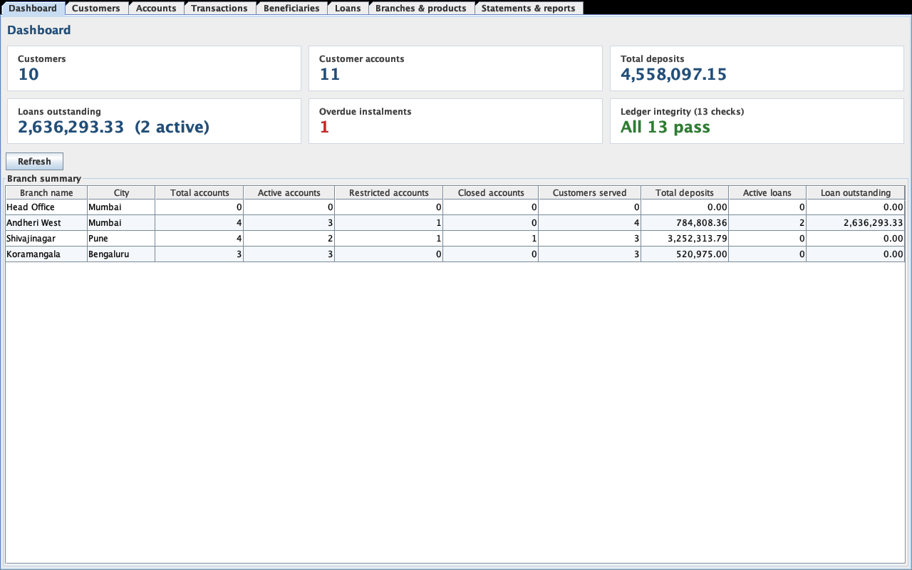
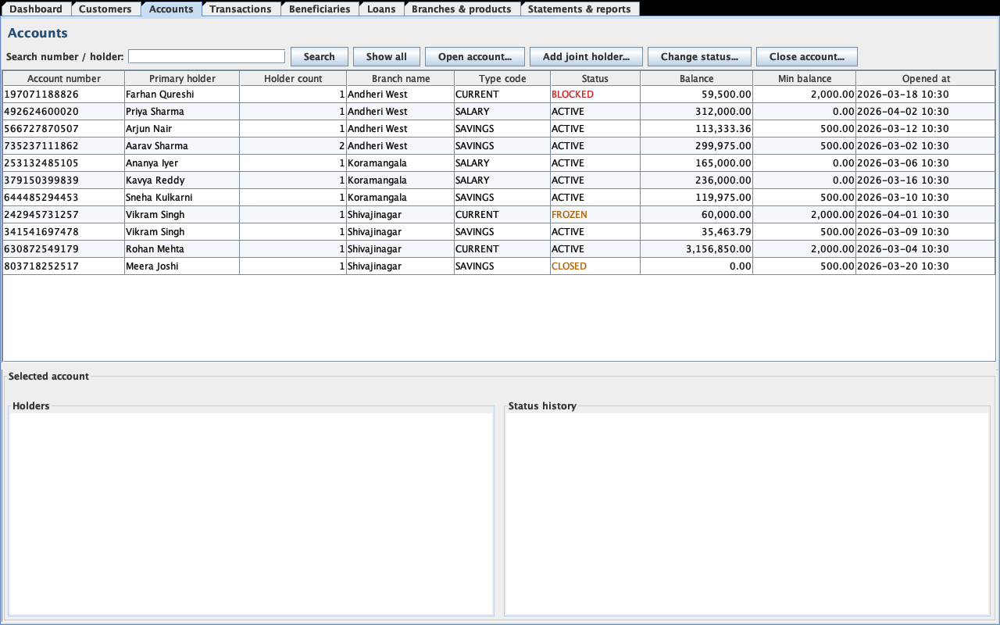
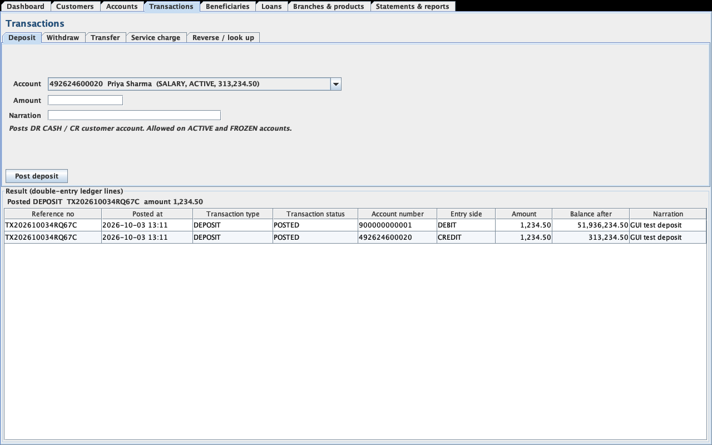
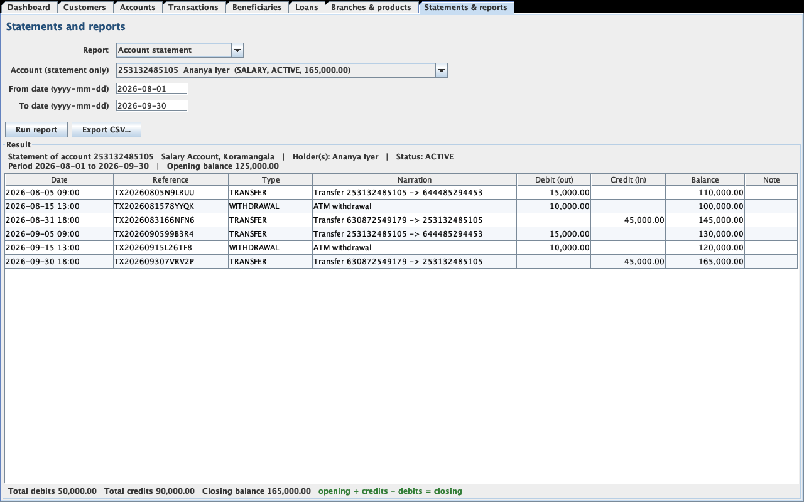

# 07 — User Guide

After completing the README setup, start the **desktop application** with `java -jar target/bank-dbms.jar`, or double-click the jar. The examples use the sample data (`scripts/setup_database.sh --with-sample-data`).

## A. Desktop application

The window has one tab per area. Selecting a tab reloads its data from the database. Problems (invalid input, insufficient funds, a blocked account...) appear in a dialog with a plain explanation, and nothing is saved.

| Tab | What you can do |
|---|---|
| **Dashboard** | Headline figures (customers, deposits, loans outstanding, overdue instalments), the ledger integrity result, and the branch summary |
| **Customers** | Search; register or edit a customer; see the selected customer's accounts |
| **Accounts** | Search; open an account (customer, branch and product drop-downs); add a joint holder; change status; close (with payout). Selecting an account shows its holders and status history |
| **Transactions** | Deposit, Withdraw, Transfer (own account or saved beneficiary), Service charge, Reverse / look up. After posting, the double-entry ledger lines are shown |
| **Beneficiaries** | Pick a customer; add, rename, deactivate or reactivate saved payees |
| **Loans** | Loan portfolio; select a loan to see its schedule (PAID / OVERDUE / PENDING); disburse a loan (with live EMI preview); repay the next instalment |
| **Branches & products** | Branches (create, edit contact details) and account types (create products) |
| **Statements & reports** | Account statement and every report; date range; Export CSV |






**A quick tour:**
1. **Dashboard:** note 1 overdue instalment.
2. **Loans:** select Arjun Nair's loan to see instalment 5 OVERDUE, then **Repay next instalment...**.
3. **Transactions → Deposit:** pick Ananya Iyer's account, enter 500, click **Post deposit**.
4. **Transactions → Withdraw:** pick Farhan Qureshi's (BLOCKED) account. The dialog explains it cannot be debited.
5. **Statements & reports:** run **Account statement** for Ananya, 2026-09-01 to 2026-09-30. The footer confirms opening + credits − debits = closing.
6. **Statements & reports → Ledger integrity check:** all 13 checks pass.

## B. Console mode (optional)

Start with `java -jar target/bank-dbms.jar --console`.

Account and loan numbers are generated randomly. Look them up first with **Accounts → Search accounts** (type a holder name) or **Reports → Account balances**.

### B.1 Navigation

```
=== Main Menu ===
 1. Customers
 2. Branches and products
 3. Accounts
 4. Transactions (deposit, withdraw, transfer, charge, reverse)
 5. Beneficiaries
 6. Loans
 7. Statements and reports
 0. Exit
```

- **Choosing:** type the number and press Enter. `0` goes back; `0` on the main menu exits.
- **Accounts:** always entered by their 12-digit account number.
- **Amounts:** accept `1500`, `1500.50` or `1,500.50`, with at most two decimals.
- **Dates:** use `yyyy-mm-dd`; blank accepts the default shown in brackets.
- **Errors:** shown as `ERROR: <reason>`. Nothing is saved when an error is shown.

### B.2 A guided tour

| Step | Menu path | What to enter | What you should see |
|---|---|---|---|
| 1 | 7 → 2 Account balances | — | 11 customer accounts across 3 branches, including FROZEN, BLOCKED and CLOSED ones |
| 2 | 3 → 2 View account | Aarav Sharma's savings number | Two holders (PRIMARY Aarav, JOINT Priya) and the status history |
| 3 | 4 → 1 Deposit | Ananya Iyer's salary account, `500`, `Counter deposit` | `OK: DEPOSIT posted: reference TX…` and the two ledger lines (DR CASH, CR account) |
| 4 | 4 → 2 Withdraw | same account, `-5` | `ERROR: Withdrawal amount must be greater than zero.` |
| 5 | 4 → 3 Transfer to own account | from Ananya's account to Kavya Reddy's | `ERROR: … belongs to a different customer: add it as a beneficiary first.` |
| 6 | 5 → 2 List beneficiaries | customer id of Rohan Mehta (3) | Three salary beneficiaries |
| 7 | 4 → 2 Withdraw | Farhan Qureshi's (BLOCKED) account | `ERROR: Account … is BLOCKED and cannot be debited.` |
| 8 | 6 → 2 View loan | Arjun Nair's PERSONAL loan number (from 6 → 5) | Schedule with 4 PAID, instalment 5 OVERDUE, the rest PENDING |
| 9 | 6 → 3 Repay next instalment | same loan, the amount shown | Instalment 5 repaid; the overdue count drops |
| 10 | 7 → 1 Account statement | Ananya's account, `2026-09-01` to `2026-09-30` | Opening balance, lines with running balance, totals, and `[opening + credits - debits = closing]` |
| 11 | 4 → 6 Reverse a transaction | the reference from step 3 | The deposit is shown, then a REVERSAL is posted; the statement marks the original "reversed" |
| 12 | 7 → 8 Trial balance | — | Debit column total = credit column total |
| 13 | 7 → 11 Ledger integrity check | — | 13 checks, all PASS |

A recorded run of steps 1, 3, 4, 5, 7, 8, 10, 12 and 13 (against the final build) is in [evidence/console_session.txt](evidence/console_session.txt).

## C. Common tasks (both interfaces)

**Open an account (3 → 1):**
1. Register the customer first (1 → 1). The holder must be at least 18.
2. Enter the customer id, branch id (2 → 1 lists branches) and product id (1 SAVINGS, 2 CURRENT, 3 SALARY).
3. Enter the opening deposit. It must be at least the product's minimum: 1,000 / 5,000 / 0.

**Pay someone else (5 → 1, then 4 → 4):**
1. Add the payee's account as a beneficiary of the paying customer.
2. Use "Transfer to beneficiary" with the beneficiary id.

**Freeze, block or close (3 → 4, 3 → 5):**
- FROZEN accepts deposits but no debits. BLOCKED accepts nothing.
- Closing needs ACTIVE status and no unpaid loan instalments. It pays out the remaining balance and cannot be undone.

**Correct a mistake (4 → 6):** reverse the transaction by its reference. Loan transactions cannot be reversed. A deposit whose money has already been spent cannot be reversed, because the account would go negative.

**Loans (6 → 1):**
- The borrower must hold the chosen account, and it must be ACTIVE.
- The rate must be above 0% and at most 36%; the tenure 1–360 months.
- The EMI and schedule are generated immediately.

## D. Troubleshooting

| Message | Cause / fix |
|---|---|
| `Database settings are missing…` | Create `db.properties` from `db.properties.example`. |
| `Cannot connect to the database…` | MySQL is not running, or the URL or password is wrong. Details are in `logs/bank-dbms.log`. |
| `Internal account CASH is missing; run sql/04_reference_data.sql` | The schema was installed without reference data. |
| `The account is busy with another operation. Please try again.` | A lock wait or deadlock timeout; retry. |
| `An unexpected error occurred…` | A bug or environment problem. The stack trace is in `logs/bank-dbms.log`; please report it. |
